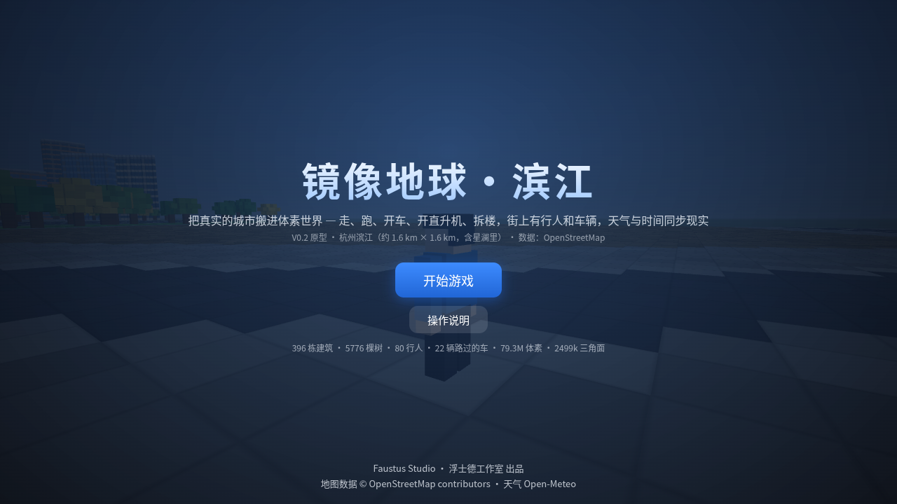
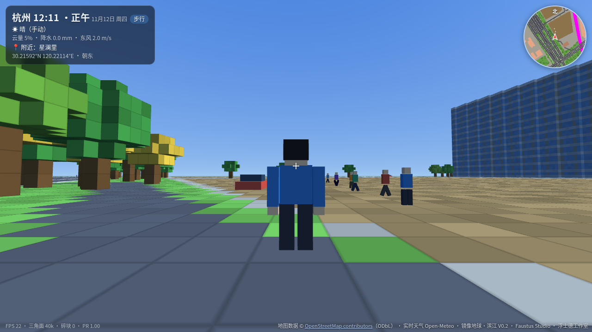
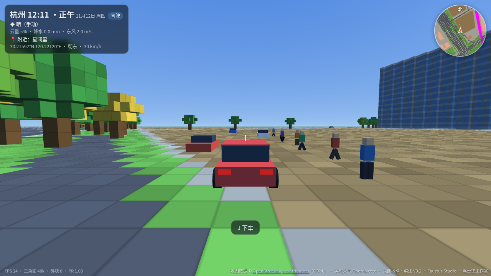
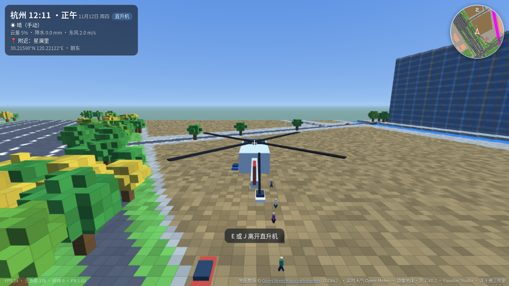
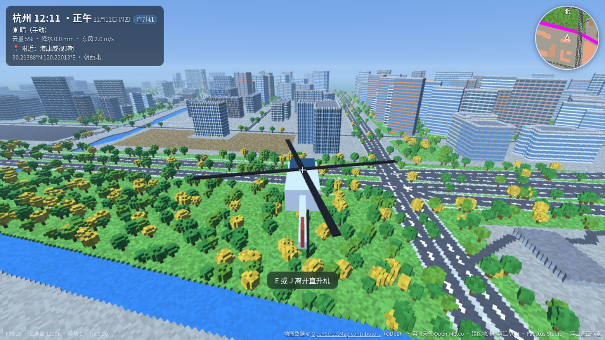

# 镜像地球·滨江 Mirror Hangzhou

杭州滨江的体素沙盒：用 OpenStreetMap 烘焙出约 1.6 km × 1.6 km 的街区，步行、开车、开直升机，也可以拆楼。天气可同步 Open-Meteo。A voxel sandbox of Binjiang, Hangzhou, baked from OpenStreetMap.

**▶ 在线试玩 / Play:** https://creacentblue.github.io/mirror-hangzhou/

建议在电脑上玩（键盘 + 鼠标）。手机也有触屏操作，建议横屏。Best on a computer with keyboard and mouse; touch controls are available on phones (landscape recommended).



| 街景 | 开车 | 直升机 | 俯瞰 |
|---|---|---|---|
|  |  |  |  |

## 操作 / Controls

- **WASD** 移动，鼠标转动视角，Shift 奔跑，空格跳跃 / move, mouse look, sprint, jump
- **J** 上车或下车 / enter or exit a car
- **U** 召唤或驾驶直升机；空格上升，C 下降，E 或 J 离开 / call or fly a helicopter; Space up, C down, E or J to exit
- **B** 或鼠标左键破坏，**Q** 或鼠标右键爆破 / break, blast
- **T / Y** 切换时间、天气；**H** 或 Esc 帮助与暂停 / time and weather, help / pause

## 本地运行 / Run locally

用浏览器打开 `index.html` 即可。three.js 已内联，离线可玩；实时天气需要访问 [Open-Meteo](https://open-meteo.com/)。Open `index.html` in a modern browser. three.js is bundled (works offline); live weather needs Open-Meteo.

## 从源码构建 / Build from source

源码在 `src/`。需要 [esbuild](https://esbuild.github.io/)（`npm install esbuild` 或系统已安装即可）：

```bash
python3 build.py          # 生成 index.html
python3 build.py --bake   # 先用 data/osm.xml 重新烘焙再构建
python3 tools/fetch_osm.py  # 重新下载 OpenStreetMap 数据
```

---
© 2026 Faustus Studio · 浮士德工作室。地图数据 © [OpenStreetMap contributors](https://www.openstreetmap.org/copyright)（ODbL）。实时天气 [Open-Meteo](https://open-meteo.com/)。
